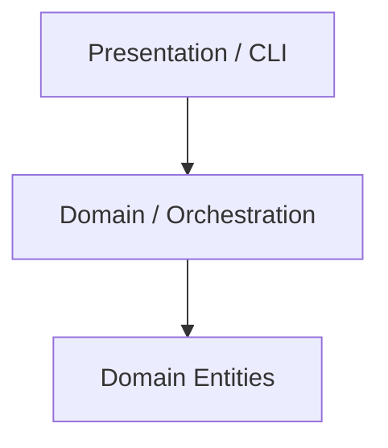

# Architecture Specification

> Generated by openlore v1.2.0 on 2026-11-05 16:56

## Purpose

This document describes the architectural patterns and structure of the system.

## Architecture Style

Layered architecture: CLI presentation and input parsing delegate to domain coordination and
simulation services, which operate over core entities and behavioral policies.

## Requirements

### Requirement: LayeredArchitecture

The system SHALL maintain separation between:
- Presentation / CLI (Handles command-line input parsing, interactive menus, terminal rendering, and visual animations)
- Domain / Orchestration (Coordinates story progression, combat simulations, boss encounters, and AI decision policies)
- Domain Entities (Represents core state models, memory unlock data, character templates, and combatant statistics)

#### Scenario: LayerSeparation
- **GIVEN** a request from the presentation layer
- **WHEN** business logic is needed
- **THEN** the presentation layer delegates to the business layer
- **AND** direct database access from presentation is prohibited

### Requirement: SecurityModel

The system SHALL implement security via: No authentication or authorization model is evident from the code analysis; the application operates as a local, single-user terminal simulation.

#### Scenario: AuthenticatedAccess
- **GIVEN** an unauthenticated request
- **WHEN** accessing protected resources
- **THEN** access is denied

## System Diagram

## Layer Structure

### Presentation / CLI

**Purpose**: Handles command-line input parsing, interactive menus, terminal rendering, and visual animations
**Location**: `Program, CliService, Display, TowerDisplay, DeathAnimation, Theme, EnvironmentScenes`

### Domain / Orchestration

**Purpose**: Coordinates story progression, combat simulations, boss encounters, and AI decision policies
**Location**: `StoryRunner, Simulation, StoryBosses, Archetypes, Policies, AspectPolicies`

### Domain Entities

**Purpose**: Represents core state models, memory unlock data, character templates, and combatant statistics
**Location**: `StoryMemory, NarrativeState, ArchetypeInfo, Combatant`

## Data Flow

User terminal input is parsed by Program / CliService and routed to either StoryRunner for narrative
progression or Simulation for combat execution → StoryRunner evaluates dialogue choices and unlocks
StoryMemory into NarrativeState, while Simulation instantiates Combatants from ArchetypeInfo and
executes turn cycles using Policies → Results and visual scenes are formatted via Theme / Display
and rendered to the terminal console; persistence mechanisms beyond in-memory state are not
evidenced in the analysis data.

## External Integrations

| System | Purpose |
|--------|---------|
| Spectre.Console (terminal styling and color palette management) | External integration |
| Ink Narrative Engine (interactive story progression via external function bindings) | External integration |
